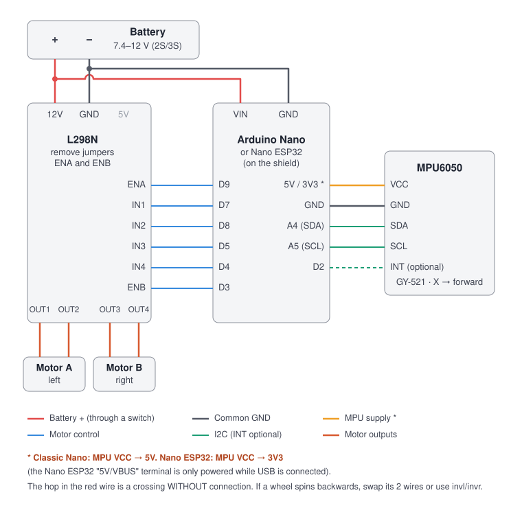

# Self-balancing robot with PID — Arduino Nano / Nano ESP32

Two-wheeled inverted pendulum with an MPU6050, an L298N driver and DC motors. This repository includes:

- **One firmware** for both the classic Arduino Nano and the Arduino Nano ESP32. Both use the same terminal shield and the same wires.
- **Cascade control:** angle PID plus a speed loop. It stops the drift without needing encoders.
- **Guided calibration:** gyro, upright and "forward" direction. It works even if the MPU is mounted rotated or sideways.
- **WiFi app** (Nano ESP32): joystick to drive forward, backward and turn; **live** PID tuning; real-time plot.
- **Live tuning over the Serial Monitor** (classic Nano): the same commands, stored in EEPROM.
- **MATLAB simulation** of the robot with the same controller, stability maps and comparison with LQR.
- **No external libraries.**

```
firmware/balance_robot/   Arduino IDE sketch (balance_robot.ino + config.h + mpu6050_raw.h + web_page.h)
matlab/                   simulation and analysis (see matlab/README.md)
docs/wiring.svg           wiring diagram
legacy/Code/              previous code (DMP + LMotorController), kept for reference only
```

---

## 1. Wiring



| From | To | Note |
|---|---|---|
| Battery + (through a switch) | L298N **12V** and Arduino **VIN** | 7.4 V (2×18650) for 6 V motors; 11.1 V (3S) for 12 V motors |
| Battery − | L298N **GND** and Arduino **GND** | **Common GND** for everything |
| D9 / D7 / D8 | ENA / IN1 / IN2 | Motor A, left. **Remove the ENA jumper** |
| D5 / D4 / D3 | IN3 / IN4 / ENB | Motor B, right. **Remove the ENB jumper** |
| L298N OUT1–OUT2 / OUT3–OUT4 | Left / right motor | If a wheel spins backwards: `invl` / `invr` |
| A4 / A5 | MPU6050 SDA / SCL | Keep these wires short |
| **5V** (classic Nano) or **3V3** (Nano ESP32) | MPU6050 VCC | ⚠️ On the Nano ESP32 the "5V/VBUS" terminal is only powered while USB is connected |
| D2 | MPU6050 INT | Optional (the firmware does not use it) |

- Keep the L298N **5V jumper on** if the battery is ≤ 12 V, and leave the L298N 5V terminal unconnected.
- **MPU mounting:** fix it firmly, with no play, close to the wheel axle and centred. Its orientation does not matter, because calibration detects it.
- Pins can be changed in [`config.h`](firmware/balance_robot/config.h).

## 2. Uploading the firmware

1. Open `firmware/balance_robot/balance_robot.ino` in Arduino IDE 2.
2. Select the board:
   - **Arduino Nano:** *Tools → Board → Arduino AVR Boards → Arduino Nano*. If the upload fails, choose *Processor → ATmega328P (Old Bootloader)*.
   - **Nano ESP32:** install the *esp32 by Espressif* package (or *Arduino ESP32 Boards*) and choose *Arduino Nano ESP32*.
3. Upload the sketch. No libraries need to be installed.
4. Open the Serial Monitor at **115200** with the **"Newline"** line ending.

## 3. First start-up (do it in this order)

With the robot **wheels in the air**, held by hand or on a stand:

| Step | Command (serial) / button (app) | What to do |
|---|---|---|
| 1 | *(automatic at power-up)* | The gyro calibrates itself: keep the robot **still for 2 s** when you power it on |
| 2 | `calup` · **2 · Upright** | Hold the robot **still at its balance point** for 1 s |
| 3 | `calfwd` · **3 · Forward** | Tilt it **~20° towards the side you want to be "forward"** and hold it for 1 s |
| 4 | `info` | Check that tilting it forward makes `angle` **positive** |
| 5 | `mt` · **Motor test** | Each wheel must spin **forward**. If one spins backwards: `invl` or `invr`, then `save` |
| 6 | `ramp` · **Min PWM ramp** | Robot **standing on the floor**, held by hand. When the wheels really start turning: `ok` · **They turn!**, then `save` |
| 7 | `on` · **Balance ON** | Stand it upright and let go gently: it starts on its own after 0.4 s nearly upright |

Calibrations and tests **disable balancing** for safety: send `on` when you are done. On a brand-new board, balancing stays off until you calibrate and send `on`. If the robot tilts past 40°, it cuts the motors; it restarts on its own once you stand it upright.

## 4. Tuning the PID

The default values come from the simulation with TT 1:48 motors and 2×18650 cells, where they survive ±30–50 % changes in mass, height, motors and battery. Still, every robot is different. Procedure:

1. **`kp`** (45). Raise it until the robot reacts firmly and starts to vibrate fast, then lower it by ~25 %.
   - Too low: it slowly falls to one side.
   - Too high: it vibrates or shakes fast.
2. **`kd`** (0.6). Damping. Raise it if it oscillates slowly back and forth; lower it if it buzzes or vibrates.
3. **`trim`**. If it always rolls towards the same side, correct it in 0.1° steps. You can also set **`kis` 0.5–2** so it corrects itself.
4. **`ks`** (20) and **`tauv`** (0.2) form the speed loop.
   - If it keeps moving away faster and faster until it falls, raise `ks`.
   - If it "pumps" (slow back-and-forth oscillation), lower `ks` or `tauv`.
5. **`minpwm`** (measured by `ramp`). If it trembles while standing, lower `minpwm` or raise `db`. If it reacts late to small angles, raise it.
6. **`ki`** usually stays at 0: the speed loop already corrects a constant lean.

Everything changes live: `kp 50`, `kd 0.8`, `trim -0.3`… Send `off` and then `save` to store it (it is not saved while balancing). With `tel 1` you can watch angle, target, speed and PWM in the IDE **Serial Plotter**.

> **Before touching the robot,** try the gains in `matlab/simulate_robot.m`: it is much faster and breaks nothing.

## 5. WiFi app (Nano ESP32)

1. Power the robot on. It creates a network called **`BalanceBot-XXXX`**, password **`balance123`** (you can change it in `config.h`). The exact name is shown by the `info` command.
2. Join it from your phone or PC. If the phone warns "no internet", choose to stay connected.
3. Open **http://192.168.4.1**.

The app works in any browser (Android, iPhone or PC) and needs no installation:

- **Joystick:** up = forward, down = backward, sides = turn. On a PC the arrow keys or WASD work too. The robot leans only as much as needed to reach the requested speed, and brakes on its own when you let go.
- **Live tuning** of every parameter with sliders, plus *Save / Reload / Default PID*.
- **Plot** of angle, target and PWM over the last 20 s.
- **Calibration and test buttons** (the same steps as section 3).
- **Safety:** if the app stops sending commands for 0.6 s (page closed or WiFi lost), the drive command returns to 0.

Moving **sideways** is not possible: a two-wheeled robot can only go forward, backward and turn.

## 6. Serial Monitor commands

| Command | Action |
|---|---|
| `help` · `get` · `info` | Help, parameters, current status (including the WiFi name) |
| `kp 45` `ki 0` `kd 0.6` `dlpf 0.5` `trim 0` `ks 20` `kis 0` `vmax 0.35` `tauv 0.2` `lean 10` `minpwm 28` `db 2` `turn 60` `alpha 0.99` | Change a parameter live (without a number, it shows the value) |
| `on` / `off` | Enable / disable balancing |
| `save` · `load` · `reset` | Save to memory · reload · default PID (calibration is kept) |
| `calg` · `calup` · `calfwd` | Calibrate gyro · upright · forward |
| `mt` · `ramp` · `ok` · `stop` | Motor test · minimum-PWM ramp · confirm · cancel |
| `invl` · `invr` | Reverse the left / right motor |
| `i2c` | Scan the I2C bus (wiring check) |
| `wifi` | Nano ESP32 radio check: TX power and the networks the robot can hear |
| `tel 1` / `tel 0` | Telemetry for the Serial Plotter |
| `d 0.5 0.2` | Drive command: forward and turn (−1..1) for 0.6 s |

The same commands work through an HC-05 Bluetooth module on the serial port and a terminal app on your phone.

## 7. How it works

```
              ┌──────────────── outer loop (speed) ──────────────────────┐
joystick ─► vRef ─►(+)─► ks + kis/s ─► target ─►(+)─► angle PID ─► PWM ─► L298N ─► motors
                   (−)                           (−)       ▲                 │
                    │                             │   filtered gyro          │
                    └──── vEst = filter(PWM) ◄────┼──────────────────────────┘
                                                  └── angle ◄─ complementary filter ◄─ MPU6050
```

- **Angle:** complementary filter at 200 Hz: `angle = α·(angle + ω·dt) + (1−α)·accelerometer_angle`. It uses the calibrated axes, so the MPU orientation does not matter.
- **D term:** uses the **gyro** rate, filtered. It does not differentiate the angle, so it does not amplify noise.
- **Speed loop:** without encoders, speed is estimated by filtering the applied PWM. At constant speed the PWM is proportional to speed because of the back-EMF. Without this loop, an angle-only PID is **unstable** with DC motors: the robot drifts faster and faster and falls. This is shown in [`matlab/linear_analysis.m`](matlab/linear_analysis.m).
- **Output:** dead band and a jump to `minpwm` to overcome gearbox friction, plus the differential turn term.
- **Real time:**
  - Classic Nano: exact 5 ms loop with `micros()`.
  - Nano ESP32: control runs in its own FreeRTOS task with a higher priority than WiFi, so the app never delays balancing.
- **Robustness:** if the MPU6050 is missing or stops responding, the motors stay off and the firmware retries once per second. Short I2C timeouts keep a bad bus from stalling the loop.

## 8. MATLAB simulation

[](https://matlab.mathworks.com/open/github/v1?repo=gttealainctorw/self-balancing-robot-pid&file=matlab/simulate_robot.m)

Without MATLAB installed, the button opens the repository in **MATLAB Online** (you only need a MathWorks account; students can sign in with their university email). It opens `simulate_robot.m`: press **Run**. With desktop MATLAB:

```matlab
cd matlab
simulate_robot     % nonlinear robot + same controller + push + joystick + animation
linear_analysis    % poles, kp–kd and ks–tauv stability maps, LQR
```

Put your robot's measurements in `robot_params.m`. Model details and how to measure each parameter are in [matlab/README.md](matlab/README.md).

## 9. Classic Nano or Nano ESP32?

Both balance with the same algorithm. **Recommended: Nano ESP32**:

- it has the WiFi app to drive it and tune the PID without cables;
- its processor is much faster, so there is plenty of spare time in each 5 ms cycle (see `loop_us` in `info`);
- it swaps in without rewiring, because it uses the same shield and the same pins. **Just move the MPU VCC wire from 5V to 3V3.**

## 10. Troubleshooting

| Symptom | Likely cause |
|---|---|
| Nano ESP32: `No DFU capable USB device` or `Cannot open DFU device` when uploading | The Windows DFU driver is missing. In the IDE: *Boards Manager → "Arduino ESP32 Boards" (by Arduino) → Install* and accept the driver installation. Then unplug and replug the USB cable |
| Nano ESP32 shows up as **"ESP32 Family Device"** on another COM port, and DFU upload fails (`exit status 74`) | The board is in the ROM bootloader. Press its RESET button once, or upload with *Tools → Programmer → Esptool* + *Sketch → Upload Using Programmer* on that port |
| `ERROR: MPU6050 not found` / `imu=ERROR` | SDA/SCL swapped, missing GND, or VCC on the Nano ESP32's 5V/VBUS terminal without USB. Run `i2c`: it should list `0x68` |
| The angle increases when you tilt it backwards | Repeat `calfwd`, tilting it towards the side you want to be forward |
| The wheels push towards the side it is falling to (making it worse) | Motors reversed: `mt`, then `invl` / `invr` |
| One wheel turns and the other does not | The ENA/ENB jumper is still on, or a wire is loose on the L298N |
| It resets when the motors start | Low battery, or thin/long power wires. Add a 470 µF capacitor at the L298N input |
| It balances but always drifts to one side | Adjust `trim`, or set `kis 1` |
| It vibrates fast | `kp` or `kd` too high, or `minpwm` too high. Loose MPU mounting |
| I cannot see the WiFi network | Only the Nano ESP32 has WiFi; the Serial Monitor (`info`) shows the network name |

## Credits

Based on the idea and schematic of [adoodevv/self_balancing_robot](https://github.com/adoodevv/self_balancing_robot) (MIT). The firmware, app and simulation in this repository were rewritten from scratch.
