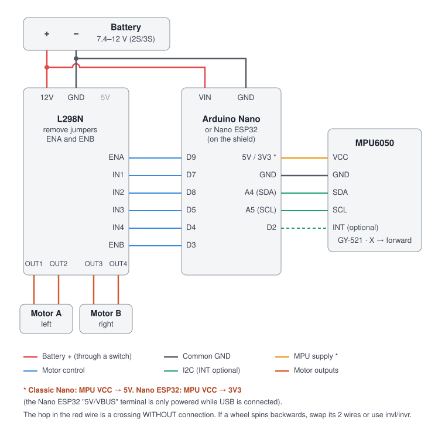
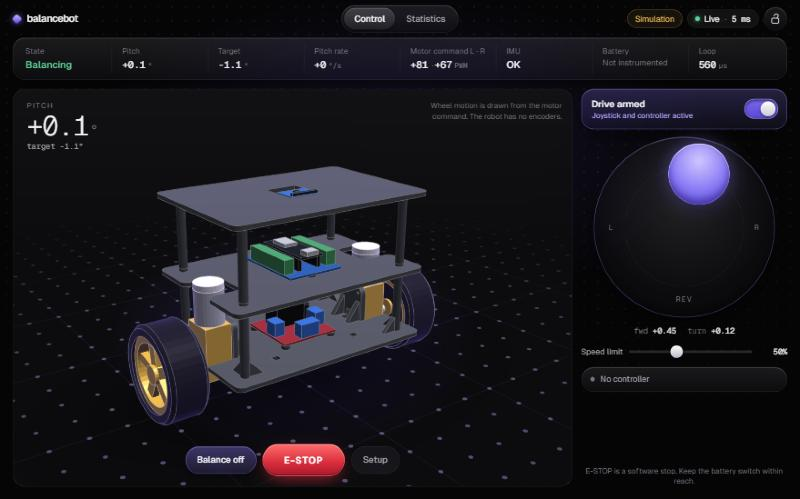
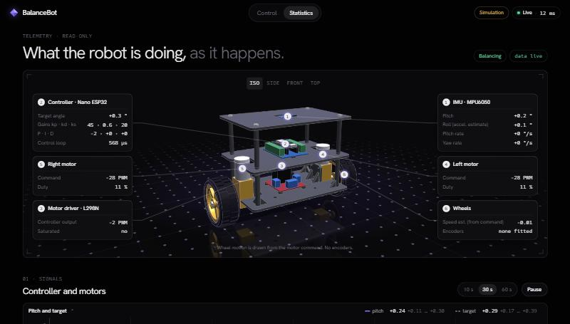

# Self-balancing robot with PID — Arduino Nano / Nano ESP32

Two-wheeled inverted pendulum with an MPU6050, an L298N driver and DC motors. This repository includes:

- **One firmware** for both the classic Arduino Nano and the Arduino Nano ESP32. Both use the same terminal shield and the same wires.
- **Cascade control:** angle PID plus a speed loop. It stops the drift without needing encoders.
- **Guided calibration:** gyro, upright and "forward" direction. It works even if the MPU is mounted rotated or sideways.
- **Web app** (Nano ESP32), two pages that can be open on two devices at once:
  - **Control:** joystick, Xbox controller, drive lock, E-STOP, live tuning, calibration.
  - **Statistics:** annotated 3D digital twin, live charts, diagnostics, recordings with CSV export.
- **Live tuning over the Serial Monitor** (classic Nano): the same commands, stored in EEPROM.
- **MATLAB simulation** of the robot with the same controller, stability maps and comparison with LQR.
- **No external libraries.**

```
firmware/balance_robot/   Arduino IDE sketch (balance_robot.ino + config.h + mpu6050_raw.h + web_assets.h)
web/                      sources of the web app, fonts and the CAD files of the digital twin
tools/                    build scripts and the development server (Python, standard library only)
matlab/                   simulation and analysis (see matlab/README.md)
docs/                     wiring diagram, project audit, design research, implementation notes
legacy/Code/              previous code (DMP + LMotorController), kept for reference only
```

---

## 1. Wiring



| From | To | Note |
|---|---|---|
| Battery + (through a switch) | L298N **12V** and Arduino **VIN** | 7.4 V (2×18650) for 6 V motors; 11.1 V (3S) for 12 V motors |
| Battery − | L298N **GND** and Arduino **GND** | **Common GND** for everything |
| D9 / D7 / D8 | ENA / IN1 / IN2 | Motor A, left. **Remove the ENA jumper** |
| D5 / D4 / D3 | IN3 / IN4 / ENB | Motor B, right. **Remove the ENB jumper** |
| L298N OUT1–OUT2 / OUT3–OUT4 | Left / right motor | If a wheel spins backwards: `invl` / `invr` |
| A4 / A5 | MPU6050 SDA / SCL | Keep these wires short |
| **5V** (classic Nano) or **3V3** (Nano ESP32) | MPU6050 VCC | ⚠️ On the Nano ESP32 the "5V/VBUS" terminal is only powered while USB is connected |
| D2 | MPU6050 INT | Optional (the firmware does not use it) |

- Keep the L298N **5V jumper on** if the battery is ≤ 12 V, and leave the L298N 5V terminal unconnected.
- **MPU mounting:** fix it firmly, with no play, close to the wheel axle and centred. Its orientation does not matter, because calibration detects it.
- Pins can be changed in [`config.h`](firmware/balance_robot/config.h).

## 2. Uploading the firmware

1. Open `firmware/balance_robot/balance_robot.ino` in Arduino IDE 2.
2. Select the board:
   - **Arduino Nano:** *Tools → Board → Arduino AVR Boards → Arduino Nano*. If the upload fails, choose *Processor → ATmega328P (Old Bootloader)*.
   - **Nano ESP32:** install the *esp32 by Espressif* package (or *Arduino ESP32 Boards*) and choose *Arduino Nano ESP32*.
3. Upload the sketch. No libraries need to be installed.
4. Open the Serial Monitor at **115200** with the **"Newline"** line ending.

## 3. First start-up (do it in this order)

With the robot **wheels in the air**, held by hand or on a stand:

| Step | Command (serial) / button (app) | What to do |
|---|---|---|
| 1 | *(automatic at power-up)* | The gyro calibrates itself: keep the robot **still for 2 s** when you power it on |
| 2 | `calup` · **2 · Upright** | Hold the robot **still at its balance point** for 1 s |
| 3 | `calfwd` · **3 · Forward** | Tilt it **~20° towards the side you want to be "forward"** and hold it for 1 s |
| 4 | `info` | Check that tilting it forward makes `angle` **positive** |
| 5 | `mt` · **Motor test** | Each wheel must spin **forward**. If one spins backwards: `invl` or `invr`, then `save` |
| 6 | `ramp` · **Min PWM ramp** | Robot **standing on the floor**, held by hand. When the wheels really start turning: `ok` · **They turn!**, then `save` |
| 7 | `on` · **Balance ON** | Stand it upright and let go gently: it starts on its own after 0.4 s nearly upright |

Calibrations and tests **disable balancing** for safety: send `on` when you are done. On a brand-new board, balancing stays off until you calibrate and send `on`. If the robot tilts past 40°, it cuts the motors; it restarts on its own once you stand it upright.

## 4. Tuning the PID

The default values come from the simulation with TT 1:48 motors and 2×18650 cells, where they survive ±30–50 % changes in mass, height, motors and battery. Still, every robot is different. Procedure:

1. **`kp`** (45). Raise it until the robot reacts firmly and starts to vibrate fast, then lower it by ~25 %.
   - Too low: it slowly falls to one side.
   - Too high: it vibrates or shakes fast.
2. **`kd`** (0.6). Damping. Raise it if it oscillates slowly back and forth; lower it if it buzzes or vibrates.
3. **`trim`**. If it always rolls towards the same side, correct it in 0.1° steps. You can also set **`kis` 0.5–2** so it corrects itself.
4. **`ks`** (20) and **`tauv`** (0.2) form the speed loop.
   - If it keeps moving away faster and faster until it falls, raise `ks`.
   - If it "pumps" (slow back-and-forth oscillation), lower `ks` or `tauv`.
5. **`minpwm`** (measured by `ramp`). If it trembles while standing, lower `minpwm` or raise `db`. If it reacts late to small angles, raise it.
6. **`ki`** usually stays at 0: the speed loop already corrects a constant lean.

Everything changes live: `kp 50`, `kd 0.8`, `trim -0.3`… Send `off` and then `save` to store it (it is not saved while balancing). With `tel 1` you can watch angle, target, speed and PWM in the IDE **Serial Plotter**.

> **Before touching the robot,** try the gains in `matlab/simulate_robot.m`: it is much faster and breaks nothing.

### Autotune (let the robot tune itself)

Press **Auto-tune** in the app (or send `autotune`). While it balances, the robot scores each set of gains for 4 s:

```
J = rms(angle error) + 0.04·rms(PWM change per step) + 3·rms(speed estimate) + 5·(time saturated)
```

That means small tilt, no jitter, no drift and no saturation. It changes `kp`, `kd` and `ks` one at a time, keeps a change only if `J` drops by more than 7 %, and halves the step when nothing helps. It finishes in about **2–6 minutes**.

- **Requirements:** calibration done, motors turning the right way (`mt`) and `minpwm` measured. Autotune can't fix wiring or reversed motors.
- **It will fall sometimes:** a fall counts as a bad score. Stand it up again and hold it still until the motors engage; it carries on by itself.
- **If the starting gains can't balance at all,** it tries bolder sets (×1.5, ×0.67, ×2, ×0.5). If none works, it stops and tells you to check motors, `minpwm` and battery.
- **The joystick is ignored while tuning.** Changing `kp`, `kd` or `ks` by hand, or pressing **OFF**, stops it.
- **When it says `Autotune done`,** press **OFF** and then **Save**.

## 5. Web app (Nano ESP32)

The robot serves a two-page web app from its own flash. No internet and no installation are needed.

1. Power the robot on. It creates a network called **`BalanceBot-XXXX`**, password **`balance123`** (you can change it in `config.h`). The exact name is shown by the `info` command.
2. Join it from your phone, tablet or PC. If the device warns "no internet", choose to stay connected.
3. Open **http://192.168.4.1/control** to drive, or **http://192.168.4.1/statistics** to watch.

The two pages are independent: open Control on one device and Statistics on another at the same time. Both read the same live telemetry, and changing the page on one device does nothing to the other.

### Control page



- **Status strip:** state, pitch, target, pitch rate, the command sent to each motor, IMU, battery and loop time.
- **Digital twin:** the robot in 3D, tilting with the measured pitch. Drag to orbit, double-click to reset the view.
- **Drive lock:** the switch above the joystick. Until you arm it, the robot only balances and ignores the joystick and the controller.
- **Joystick:** up = forward, sides = turn. On a PC the arrow keys or WASD work too. Releasing it returns to neutral.
- **Speed limit:** scales every drive command (default 50 %).
- **Balance on/off** and **E-STOP.** E-STOP turns balancing off, locks driving and cancels any test. `Space` or `Esc` on a keyboard does the same.
- **Padlock (top right):** locks you into this page so you cannot leave it by accident. Press and hold it for a second to unlock.
- **Setup:** live tuning of all 14 parameters, save/reload, auto-tune, calibration, motor tests, controller mapping and the message log.

### Statistics page



Read-only: this page only requests telemetry and never sends a command.

- **Annotated twin:** numbered cards tied to the IMU, the controller board, the motor driver, each motor and the wheels by leader lines.
- **Charts:** pitch vs target, motor command left/right, pitch rate, speed estimate and link round trip. Choose a 10, 30 or 60 s window; hover or tap for the value at a point in time.
- **Diagnostics:** operating state, IMU, sample rate received, data age, missed samples, failed polls, round trip, uptime, loop time, all controller parameters, and warnings.
- **Experiments:** press **Record**, let the robot run, press **Stop**. Each run gets a summary (RMS error, max tilt, saturation, mean command, falls) with the gains that were in force, so runs can be compared. **CSV** downloads the samples for MATLAB or a spreadsheet. Recordings are kept in that browser; nothing is stored on the robot.

### What the app shows, and what it does not

- Pitch, pitch rate and yaw rate are measured by the MPU6050. **Roll** is an accelerometer-only estimate.
- **Wheel motion** in the twin and the **speed estimate** come from the motor command, because the robot has no encoders. They are labelled as estimates and never given in m/s.
- **Battery** shows "Not instrumented" until you wire a voltage divider and set `BATTERY_SENSE 1` in `config.h` (100 kΩ from battery + to an ADC pin, 33 kΩ from that pin to GND). This option compiles but has not been tested on hardware.
- When data stops arriving, the twin dims and the read-outs show "—" instead of the last value.

### Driving safety

- Driving needs an explicit **arm** from the page that will drive. Only that page's commands count; a second control page is ignored until the first one locks.
- The drive lock closes by itself when: the page loses focus or is hidden, the controller disconnects, the link drops (no command for 2 s on the robot side), the robot falls, balancing is turned off, auto-tune starts, or the IMU fails. It never reopens by itself.
- Without a command for 0.6 s the drive command goes to neutral.
- **E-STOP is a software stop.** It depends on the WiFi link and the firmware. Keep the battery switch within reach; that is the real emergency stop.

### Xbox controller

The controller connects to **the device showing the Control page** (USB, Xbox Wireless adapter or Bluetooth), not to the robot. The browser reads it through the Gamepad API and the page sends the same command as the joystick.

| Input | Action |
|---|---|
| Left stick ↕ | Forward / back |
| Right stick ↔ | Turn (or the left stick, in single-stick layout) |
| RT | Raises the speed limit toward 100 % |
| LT | Precision: lowers the command to as little as 35 % |
| A | Arm drive |
| X | Lock drive |
| B | E-STOP |
| Menu | Balance on |

The four buttons can be reassigned in *Setup → Controller* ("Change", then press a button). Dead zone, stick layout and inversion are there too.

- **Which controllers:** any pad the browser reports with the standard mapping. Xbox One models 1537 and 1697 have no Bluetooth (use USB or the Xbox Wireless adapter); model 1708 and later also pair over Bluetooth.
- **Press a button first:** browsers only reveal a controller after a button press on the focused page.
- **Secure-context caveat:** the Gamepad API is specified for secure pages, and `http://192.168.4.1` is not one. Firefox hides the API there. In Chromium 156 the API is callable on a plain-HTTP LAN address (measured), but whether it reports a physical pad there was not tested. If your browser shows "Controller unavailable here", use the localhost bridge on a computer joined to the robot's WiFi:

  ```bash
  python tools/dev_server.py --robot http://192.168.4.1
  ```

  then open `http://localhost:8080/control`. `localhost` is a secure page in every browser, and the bridge forwards the robot's API.

### Developing the app

```
web/                 HTML, CSS and JavaScript sources, fonts, CAD files
tools/build_twin.py  STL decks + parametric parts -> web/model/robot.bin
tools/build_web.py   web/ -> firmware/balance_robot/web_assets.h
tools/dev_server.py  simulated robot, or bridge to the real one
```

```bash
python tools/dev_server.py
```

serves the app at `http://localhost:8080` against a **simulated** robot that speaks the firmware's API (the app shows a "Simulation" badge). After changing anything in `web/`:

```bash
python tools/build_web.py
```

and upload the sketch again. `web_assets.h` is committed, so the Arduino IDE needs none of these tools. The tests for the shared logic run with:

```bash
node --test web/test/lib.test.js
```

Everything uses the Python standard library; there are no npm packages. On the robot, the `webtest` serial command makes it download all of its own pages and report sizes and status.

The digital twin uses the three deck models from [adoodevv/self_balancing_robot](https://github.com/adoodevv/self_balancing_robot) (`models/` folder) as they are. Motors, wheels and boards are parametric stand-ins with catalogue dimensions, placed on the mounting features of those decks. Design decisions and the libraries that were considered are in [docs/DESIGN_AND_TECH_RESEARCH.md](docs/DESIGN_AND_TECH_RESEARCH.md).

## 6. Serial Monitor commands

| Command | Action |
|---|---|
| `help` · `get` · `info` | Help, parameters, current status (including the WiFi name) |
| `kp 45` `ki 0` `kd 0.6` `dlpf 0.5` `trim 0` `ks 20` `kis 0` `vmax 0.35` `tauv 0.2` `lean 10` `minpwm 28` `db 2` `turn 60` `alpha 0.99` | Change a parameter live (without a number, it shows the value) |
| `on` / `off` | Enable / disable balancing |
| `save` · `load` · `reset` | Save to memory · reload · default PID (calibration is kept) |
| `calg` · `calup` · `calfwd` | Calibrate gyro · upright · forward |
| `mt` · `ramp` · `ok` · `stop` | Motor test · minimum-PWM ramp · confirm · cancel |
| `invl` · `invr` | Reverse the left / right motor |
| `autotune` / `autotune stop` | Self-tune `kp`, `kd`, `ks` while it balances (see section 4) |
| `estop` | Stop: balancing off, driving locked, tests cancelled |
| `arm` / `disarm` | Nano ESP32: unlock / lock driving (needed before `d`) |
| `i2c` | Scan the I2C bus (wiring check) |
| `webtest` | Nano ESP32: the robot downloads its own web pages and reports sizes and status |
| `wifi` | Nano ESP32 radio check: TX power and the networks the robot can hear |
| `tel 1` / `tel 0` | Telemetry for the Serial Plotter |
| `d 0.5 0.2` | Drive command: forward and turn (−1..1) for 0.6 s. On the Nano ESP32 send `arm` first |

The same commands work through an HC-05 Bluetooth module on the serial port and a terminal app on your phone.

## 7. How it works

```
              ┌──────────────── outer loop (speed) ──────────────────────┐
joystick ─► vRef ─►(+)─► ks + kis/s ─► target ─►(+)─► angle PID ─► PWM ─► L298N ─► motors
                   (−)                           (−)       ▲                 │
                    │                             │   filtered gyro          │
                    └──── vEst = filter(PWM) ◄────┼──────────────────────────┘
                                                  └── angle ◄─ complementary filter ◄─ MPU6050
```

- **Angle:** complementary filter at 200 Hz: `angle = α·(angle + ω·dt) + (1−α)·accelerometer_angle`. It uses the calibrated axes, so the MPU orientation does not matter.
- **D term:** uses the **gyro** rate, filtered. It does not differentiate the angle, so it does not amplify noise.
- **Speed loop:** without encoders, speed is estimated by filtering the applied PWM. At constant speed the PWM is proportional to speed because of the back-EMF. Without this loop, an angle-only PID is **unstable** with DC motors: the robot drifts faster and faster and falls. This is shown in [`matlab/linear_analysis.m`](matlab/linear_analysis.m).
- **Output:** dead band and a jump to `minpwm` to overcome gearbox friction, plus the differential turn term.
- **Real time:**
  - Classic Nano: exact 5 ms loop with `micros()`.
  - Nano ESP32: control runs in its own FreeRTOS task with a higher priority than WiFi, so the app never delays balancing.
- **Telemetry:** the control task stores a sample every 20 ms (50 Hz). Each page polls about 10 times per second and receives every sample since its last poll, so charts and the twin get 50 Hz data over plain HTTP, for any number of devices.
- **Robustness:** if the MPU6050 is missing or stops responding, the motors stay off and the firmware retries once per second. Short I2C timeouts keep a bad bus from stalling the loop.

## 8. MATLAB simulation

[](https://matlab.mathworks.com/open/github/v1?repo=gttealainctorw/self-balancing-robot-pid&file=matlab/simulate_robot.m)

Without MATLAB installed, the button opens the repository in **MATLAB Online** (you only need a MathWorks account; students can sign in with their university email). It opens `simulate_robot.m`: press **Run**. With desktop MATLAB:

```matlab
cd matlab
simulate_robot     % nonlinear robot + same controller + push + joystick + animation
linear_analysis    % poles, kp–kd and ks–tauv stability maps, LQR
```

Put your robot's measurements in `robot_params.m`. Model details and how to measure each parameter are in [matlab/README.md](matlab/README.md).

## 9. Classic Nano or Nano ESP32?

Both balance with the same algorithm. **Recommended: Nano ESP32**:

- it has the web app: driving, Xbox controller, tuning without cables, live telemetry and the digital twin;
- its processor is much faster, so there is plenty of spare time in each 5 ms cycle (see `loop_us` in `info`);
- it swaps in without rewiring, because it uses the same shield and the same pins. **Just move the MPU VCC wire from 5V to 3V3.**

## 10. Troubleshooting

| Symptom | Likely cause |
|---|---|
| Nano ESP32: `No DFU capable USB device` or `Cannot open DFU device` when uploading | The Windows DFU driver is missing. In the IDE: *Boards Manager → "Arduino ESP32 Boards" (by Arduino) → Install* and accept the driver installation. Then unplug and replug the USB cable |
| Nano ESP32 shows up as **"ESP32 Family Device"** on another COM port, and DFU upload fails (`exit status 74`) | The board is in the ROM bootloader. Press its RESET button once, or upload with *Tools → Programmer → Esptool* + *Sketch → Upload Using Programmer* on that port |
| `ERROR: MPU6050 not found` / `imu=ERROR` | SDA/SCL swapped, missing GND, or VCC on the Nano ESP32's 5V/VBUS terminal without USB. Run `i2c`: it should list `0x68` |
| The angle increases when you tilt it backwards | Repeat `calfwd`, tilting it towards the side you want to be forward |
| The wheels push towards the side it is falling to (making it worse) | Motors reversed: `mt`, then `invl` / `invr` |
| One wheel turns and the other does not | The ENA/ENB jumper is still on, or a wire is loose on the L298N |
| It resets when the motors start | Low battery, or thin/long power wires. Add a 470 µF capacitor at the L298N input |
| It balances but always drifts to one side | Adjust `trim`, or set `kis 1` |
| It vibrates fast | `kp` or `kd` too high, or `minpwm` too high. Loose MPU mounting |
| The app shows "No link" | The device left the robot's WiFi (phones do this when a network has no internet). Rejoin it and keep the connection |
| The page loads but the 3D robot is a flat drawing | The browser has no WebGL2; the app falls back to a 2D side view |
| Controller not detected | Press a button on it with the page focused. See *Xbox controller* in section 5 for the secure-context caveat |
| I cannot see the WiFi network | Only the Nano ESP32 has WiFi; the Serial Monitor (`info`) shows the network name |
